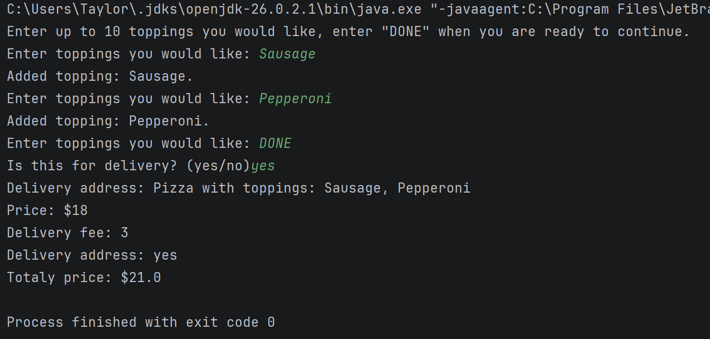

# Pizza Maker

This is a program that allows you to make a pizza with toppings, and then choose whether or not you want deliver. Then it will give you a price for the pizza (with delivery if delivery was selected).

# How to run the program

Build the program into a .jar file, and then run the program using `java -jar PizzaToppings.jar`

# Example of the program running

